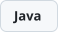
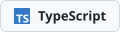
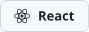

<picture>
  <source media="(prefers-color-scheme: dark)" srcset="./assets/header.dark.svg" />
  
</picture>

  <a href="#selected-work">Selected work</a> &nbsp; / &nbsp;
  <a href="#toolkit">Toolkit</a> &nbsp; / &nbsp;
  <a href="#activity">Activity</a> &nbsp; / &nbsp;
  <a href="#explore">Explore</a>

I'm a **Computer Engineering student at Politecnico di Milano**. I build web applications with Java, Spring Boot and TypeScript, with a focus on backend development, databases and usable interfaces.

Currently exploring software architecture, data management and the details that make an application reliable.

<picture>
  <source media="(prefers-color-scheme: dark)" srcset="./assets/terminal.dark.svg" />
  
</picture>

## Selected work

<table>
  <tr>
    <td width="50%" valign="top">
      
      <h3><a href="https://github.com/mchartt/SmartDesk-SE-PolimiProject">01 / SmartDesk ↗</a></h3>
      
A coworking platform for listing spaces, booking desks and managing maintenance requests.

      
<code>Java</code> <code>Spring Boot</code> <code>Angular</code> <code>MySQL</code>

      Software Engineering · Politecnico di Milano
    </td>
    <td width="50%" valign="top">
      
      <h3><a href="https://github.com/mchartt/YouTicket-2025-2026-Polimi-TIW">02 / YouTicket ↗</a></h3>
      
An IT helpdesk with ticket assignment, role-based access, attachments and real-time conversations.

      
<code>React</code> <code>TypeScript</code> <code>Express</code> <code>PostgreSQL</code>

      Web Technologies · Politecnico di Milano
    </td>
  </tr>
</table>

<a href="https://github.com/mchartt?tab=repositories">Explore public repositories →</a>

## Toolkit

  <picture><source media="(prefers-color-scheme: dark)" srcset="./assets/badges/java.dark.svg" /></picture>
  <picture><source media="(prefers-color-scheme: dark)" srcset="./assets/badges/spring.dark.svg" /></picture>
  <picture><source media="(prefers-color-scheme: dark)" srcset="./assets/badges/typescript.dark.svg" /></picture>
  <picture><source media="(prefers-color-scheme: dark)" srcset="./assets/badges/angular.dark.svg" /></picture>
  <picture><source media="(prefers-color-scheme: dark)" srcset="./assets/badges/react.dark.svg" /></picture>
  <picture><source media="(prefers-color-scheme: dark)" srcset="./assets/badges/python.dark.svg" /></picture>
  <picture><source media="(prefers-color-scheme: dark)" srcset="./assets/badges/postgresql.dark.svg" /></picture>
  <picture><source media="(prefers-color-scheme: dark)" srcset="./assets/badges/mysql.dark.svg" /></picture>
  <picture><source media="(prefers-color-scheme: dark)" srcset="./assets/badges/docker.dark.svg" /></picture>
  <picture><source media="(prefers-color-scheme: dark)" srcset="./assets/badges/git.dark.svg" /></picture>

## Activity

<picture>
  <source media="(prefers-color-scheme: dark)" srcset="./assets/contributions.dark.svg" />
  
</picture>

  

<picture>
  <source media="(prefers-color-scheme: dark)" srcset="./assets/languages.dark.svg" />
  
</picture>

### Contribution snake · randomized

<picture>
  <source media="(prefers-color-scheme: dark)" srcset="./assets/snake.dark.svg" />
  
</picture>

  
About these visuals

  
The graphics are generated twice a day by GitHub Actions and served from this repository. The 3D calendar, streaks and snake use the contribution counts already visible on my public GitHub profile, including anonymous private counts when shared. Statistics cover the last 365 days; an empty today does not break yesterday's current streak.

  
The banner, terminal ASCII art, skyline and snake are custom SVG, with reduced-motion support. Each scheduled refresh randomizes the snake's path so it seeks out and collects all active contribution days; the path is fixed during each playback because GitHub profile READMEs cannot execute JavaScript. Language cards and toolkit badges use <a href="https://github.com/seijikohara/profile-cards-action">Profile Cards</a>. Language shares measure code size across public source repositories, not proficiency.

  
<a href="https://github.com/mchartt/mchartt/actions/workflows/snake.yml">View the latest refresh →</a>

## Explore

  <a href="https://github.com/mchartt?tab=repositories">All repositories ↗</a> &nbsp; / &nbsp;
  <a href="https://github.com/mchartt/mchartt">Profile source ↗</a>

